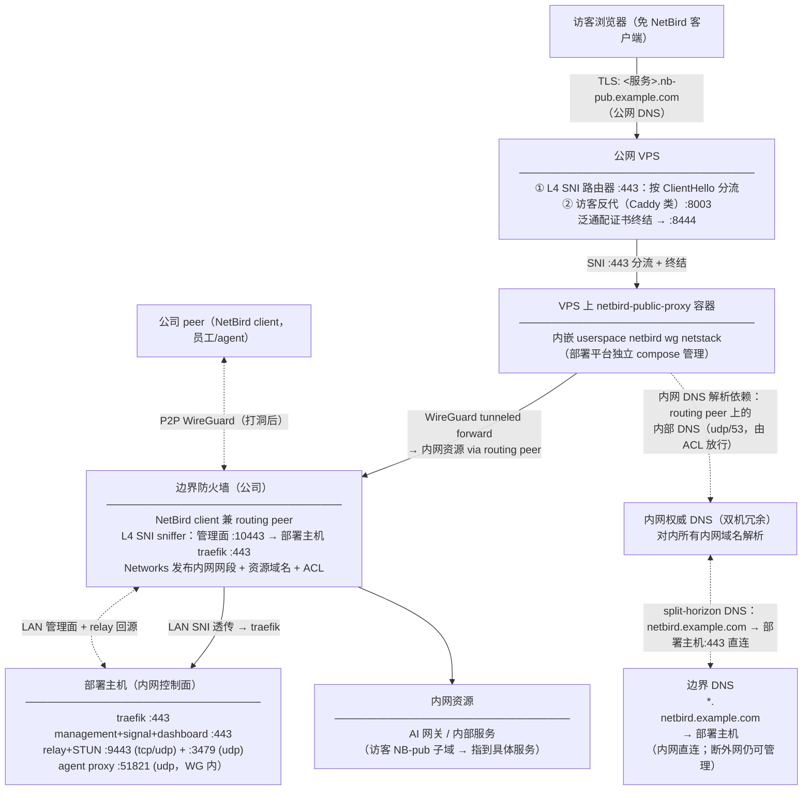
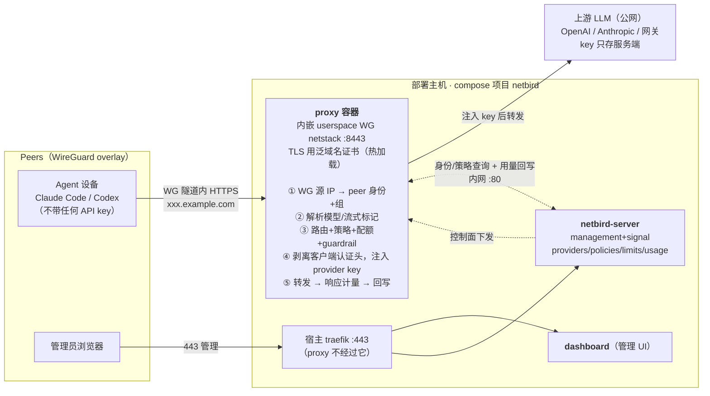

# netbird 分支

NetBird 全功能自建（VPN 管理 + **Agent Network** Beta）。管理面与 endpoint 使用
**同一个 base 域名**，下文统一以 `netbird.example.com` 指代；真实域名不入库，
部署时由部署平台项目 env 注入 `${NETBIRD_DOMAIN}`。

上游没有静态 compose 文件：官方安装入口是交互式脚本 `getting-started.sh`
（内嵌 Dex IdP，无需外部 IdP）。本分支的上游产物由 main 的 `sync-netbird.yml`
在 Action 里 **source 脚本、只调渲染函数（不部署）** 生成，渲染时使用占位域名
`netbird.example.com`——分支任何文件都不含真实域名或拓扑信息。

- 第一次渲染（`REVERSE_PROXY_TYPE=1`，外部 traefik）→ `docker-compose.upstream.yaml`
  （dashboard + netbird-server，标签为固定证书风格 `tls=true`）
- 第二次渲染（`REVERSE_PROXY_TYPE=0` + `ENABLE_PROXY=true`）→ 从中提取 proxy 服务
  → `docker-compose.upstream-proxy.yaml`（proxy 定义始终跟踪上游，非手抄）

## 文件分工

| 文件 | 用途 | 谁来改 |
|---|---|---|
| `docker-compose.upstream.yaml` | 脚本 option 1 渲染原样产物（占位域名） | 只由机器人改 |
| `docker-compose.upstream-proxy.yaml` | 脚本 option 0 渲染后提取的 proxy 片段 | 只由机器人改 |
| `docker-compose.portainer.yaml` | 全部自定义（mirror、密钥外置、agent network、域名 env 模板化） | **只手改这个** |
| `docker-compose.yaml` | 三文件预合并产物，4 个 netbirdio 镜像钉 digest，变量模板保留 | 只由机器人生成 |
| `config.yaml` | 渲染参考模板（占位域名 + 3 个密钥洗成 `__GENERATE_AT_DEPLOY__`） | 只由机器人改 |
| `dashboard.env` / `proxy.env` | 渲染参考件（占位域名；token 为 `__SET_ME__`） | 只由机器人改 |

## 平台项目 env（**5 个全部必填**，缺一部署即失败）

| 变量 | 说明 | 形态示例 |
|---|---|---|
| `NETBIRD_DOMAIN` 🆕 | 管理面/endpoint 域名。compose 内 4 条 traefik 路由、dashboard 的 4 个 URL、proxy `NB_PROXY_DOMAIN`、relay `rels://relay.${NETBIRD_DOMAIN}:9443` 全部由它派生 | `vpn.company.example` |
| `JCR_REGISTRY` 🆕 | 私服镜像 mirror 主机名。**只写主机名**（不带协议不带路径）；4 个镜像 ref 为 `${JCR_REGISTRY}/docker/netbirdio/…` | `registry.company.example` |
| `NETBIRD_CERT_DIR` 🆕 | 宿主机上泛域名证书同步落盘目录（含 `fullchain.pem` + `key.pem`），bind 进 proxy（`/wildcard-certs`）与 relay（`/certs`） | `/etc/edge-synced-certs/company.example` |
| `NB_PROXY_TOKEN` | proxy 注册到管理面的 token。首次部署先填占位值（proxy 起不来属预期），拿到真 token 后替换重建（见 bootstrap 第 5 步） | `nbx_…` |
| `NB_RELAY_AUTH_SECRET` | relay 与 management 的共享密钥。**必须与 config.yaml 里 `relays.secret`（= `server.authSecret`）同值**，错一个字符表现为 relay 健康但拒绝所有 peer | `openssl rand -base64 32 \| tr -d '='` |

其余配置全部内联在 compose 里（dashboard env 无密钥；config.yaml 走命名卷）。

## 首次 bootstrap（按序执行）

1. **DNS**（split-horizon，公网/内网各一条，同一域名不同指向）：
   - `netbird.example.com`：公网解析指向你的公网入口（见「公网接入架构」），
     内网权威 DNS 指到部署主机的 traefik（断外网时管理面仍可用）；
   - `relay.netbird.example.com`：公网指向出口静态 IP（边界映射回部署主机的
     relay 容器）；内网同样指部署主机即可。
   - `*.netbird.example.com` 公网泛解析仅在启用「公网访客入口」时才需要
     （agent network endpoint 只在 WG overlay 内解析，默认不需要）。
2. **证书**：泛域名证书须包含 `netbird.example.com` 与 `*.netbird.example.com`
   （后者仅 agent endpoint/访客入口需要），同步到宿主 `NETBIRD_CERT_DIR`。
   **proxy/relay 容器以 UID/GID 1000 运行（非 root）**，同步工具须设置：
   公钥/私钥权限 `0440`、组 `1000`（owner 保持 root），否则容器读不到私钥。
   两个文件名固定为 `fullchain.pem` + `key.pem`（override 环境变量钉死，改名要同步改）。
   ⚠️ relay 与 proxy 不同：**证书只在启动时读一次，每次续期后要
   `docker restart netbird-relay`**（proxy 有 certwatch 热加载，免介入）。
3. **端口预检**（部署主机）：UDP 3479（STUN）、UDP 51821（proxy WG）、
   TCP/UDP 9443（relay）未被占用：`ss -lunp | grep -E '3479|51821|9443'` 应为空。
   （刻意避开默认 3478/51820：示例环境里它们被边界防火墙的 TURN 插件与其自带
   NetBird 客户端占用；你的环境若没有冲突可自行调整，改动集中在 override。）
4. **生成真实 `config.yaml` 并灌入命名卷**（用分支自带脚本，纯标准库、带断言，
   杜绝手改 YAML/sed 的坑）：

   ```bash
   curl -fsSL https://raw.githubusercontent.com/xyonium/compose/netbird/config.yaml -o config.yaml
   curl -fsSL https://raw.githubusercontent.com/xyonium/compose/netbird/scripts/bootstrap-config.py -o bootstrap-config.py
   python3 bootstrap-config.py <真实域名> config.yaml config.yaml \
     "$(docker network inspect reverse-proxy -f '{{(index .IPAM.Config 0).Subnet}}')"
   # 脚本完成：占位域名全域替换、3 个随机密钥、trustedHTTPProxies 死值替换、
   # 追加外部 stuns/relays（stun:relay.<域名>:3479 / rels://relay.<域名>:9443，
   # relays.secret 自动等于 authSecret）
   grep -c GENERATE config.yaml   # 必须为 0 再继续（server 对占位符会 FATL）：
                                  # decode encryption key: illegal base64 data
   docker volume create netbird_netbird_config
   docker run --rm -v netbird_netbird_config:/cfg -v "$PWD":/src alpine \
     sh -c "cp /src/config.yaml /cfg/config.yaml"
   ```

5. **部署平台建项目**（compose 用本分支 `docker-compose.yaml`；项目 env 先填
   上表 5 个变量，`NB_PROXY_TOKEN` 可先用占位值）。待 netbird-server 正常后取真 token：

   ```bash
   docker exec netbird-server /go/bin/netbird-server admin token create \
     --name "default-proxy" --config /etc/netbird/config.yaml
   ```

   输出 `nbx_...` 填入项目 env `NB_PROXY_TOKEN`，重建项目（此前 proxy 起不来属预期）。
6. **建首个管理员**：浏览器开 `https://netbird.example.com/setup`（仅无用户时可见）。

## Agent Network 验证

1. Dashboard 左侧应出现 **Agent Network** 菜单（Peers/DNS 等常规页面同时保留——
   本部署是完整面板，非 ONLY 模式）。
2. **Agent Network → Providers → Connect Provider**：填入 provider 密钥，
   保存后生成 tunnel-only endpoint（`*.netbird.example.com` 形态）。
3. **Policies → Add Policy**：把 source group 关联到 provider（默认全拒）。
4. 测试设备连 NetBird 客户端后，在 overlay 内 curl endpoint 验证；
   **Usage & Logs** 应记录身份/模型/token/费用。
5. endpoint 证书由 proxy 容器从 `/wildcard-certs`（泛域名证书目录）提供；
   若 TLS 报错先查该挂载路径与证书 SAN。

## 公网接入架构（泛化描述，拓扑已脱敏）

双层入口并行，peer↔peer WireGuard 数据面纯 P2P（STUN 打洞 + relay 兜底）。

**管理面与访客面分离**：管理面域名在 VPS 上只做 L4 SNI 透传（TLS 端到端到内网），
访客服务子域才在 VPS 终结——两边证书、解析、失效互不影响。VPS 上除 SNI 分流器与
访客反代之外没有任何转发中间件。


_图例：`-.` 虚线 = control/DNS；`-->` 实线带文字 = data path；VPS L4 SNI 用纯 TCP 透传给
部署主机 traefik（TLS 不终结）。_

**分离公开 vs 私有 plane**

| 名称 | 谁可达 | 走的链路 | 证书来源 |
|---|---|---|---|
| 管理面（外部 peer） | 公司 NetBird client | `netbird.example.com` → VPS L4 SNI 透传 → 边界 :10443 → 部署主机 traefik :443 | 部署主机 traefik 泛域名证书 |
| 管理面（内网 peer） | 公司内网设备 | 内网 DNS 直连部署主机 traefik | 同上 |
| 访客面（browser） | 任意 internet 浏览器 | `<服务>.nb-pub.example.com` → VPS 反代 → VPS netbird-public-proxy → WG → routing peer → 内网资源 | VPS 反代自己的泛通配证书 |
| Agent Network endpoint | agent 机上 NetBird client（overlay only） | 本机 WG peer → proxy :8443 | `NETBIRD_CERT_DIR` 泛域名证书（热加载） |
| relay + STUN | 任何 peer | `relay.netbird.example.com:9443` + `3479/udp` → 边界映射 → relay 容器 | 同目录证书（**启动读一次，续期后要重启**） |

**routing peer（必要依赖）**：边界防火墙上的 NetBird client 配成 Networks 的
routing peer——发布内网目标资源（建议按域名资源 + 内网权威 DNS 两条 host 资源配），
ACL 授权源组到目标资源组（DNS 至少放行 UDP 53）。公网 proxy 容器里的内嵌 client
就是靠这条路把外部访客的请求路由进内网、并完成内网 DNS 解析的；没有它，
公网访客链路会在 proxy 日志里报解析失败、浏览器得到 502。

draw.io 可编辑源文件（脱敏版）：[docs/final-architecture.drawio](docs/final-architecture.drawio)。
旧 v1 隧道透传设计历史存档：[docs/public-access-architecture.drawio](docs/public-access-architecture.drawio)（已停用，不要盲目引用）。

## 自定义摘要（docker-compose.portainer.yaml）

- 镜像全部走 `${JCR_REGISTRY}/docker/netbirdio/*` mirror（registry 走项目 env），
  4 个主镜像钉 digest（bot 每次 sync 重钉 latest）。
- 域名全 env 化：上游 4 组 traefik router label 在 override 按同 key 全覆盖为
  `Host(\`${NETBIRD_DOMAIN}\`)` 模板（compose label 合并按 key、后者胜），
  dashboard/proxy/relay 的域名相关 env 同理。
- traefik 固定证书风格（`tls=true`，无 certresolver），override 只补 web 入口
  `http2https` 跳转一条。
- `./config.yaml` bind 挂载改为 `netbird_config` 命名卷（密钥不进 git）。
- proxy 私有模式：`NB_PROXY_PRIVATE=true`、无 traefik 路由（`traefik.enable=false`）、
  ACME 关闭、PROXY protocol 关闭——agent 流量走 WG 隧道直连 proxy。
- server 的 gRPC 路由在同一覆盖里补上了 `/management.ProxyService/` 前缀
  （上游 option-1 渲染漏了它；仅将来跨主机注册远程 proxy 时需要，先补齐防忘）。

## 公网访客入口的回退方案（当前不启用）

若 VPS 上的公网 proxy 入口要退役、改由部署主机本机对外暴露访客面：

1. override 给 proxy 加回 TCP passthrough 标签，`HostSNIRegexp` 收敛到
   `^.+\.netbird.example.com$`（**不得**用上游的 `HostSNI(*)`，会接管共享
   traefik 上其他栈的 443 流量）；
2. proxy 开 `NB_PROXY_ACME_CERTIFICATES=true`（tls-alpn-01）或继续用静态证书；
3. 内网 DNS 把 `*.服务子域` 指到部署主机（split-horizon）；
4. 需要保真实客户端 IP 时再上 PROXY protocol v2（宿主 traefik 加 file provider
   的 serversTransport 片段 + `NB_PROXY_PROXY_PROTOCOL=true`）。

**当前不实施**：VPS 外置访客入口已满足需求，管理面 mapping 简洁。

## proxy 工作机制（Agent Network 数据面）



要点：**agent 流量全程在 WireGuard 隧道内，不经过 traefik 或任何公网入口**；
身份来自 WG peer 映射（隧道即凭证），endpoint 仅 overlay 内可达；
provider key 只存服务端，客户端永远拿不到（keyless）。
draw.io 可编辑源文件（脱敏版）：[docs/proxy-architecture.drawio](docs/proxy-architecture.drawio)。

## 回滚

- sync 引入上游不兼容变更：workflow 哨兵会失败且不提交，线上不动。
- 分支历史经安全清洗重建（单 commit）：**digest 回滚链不再存在**。需要回退
  上游版本时，在部署平台把项目切回旧版 `docker-compose.yaml`（平台侧有部署历史），
  或临时手改 `docker-compose.yaml` 里的镜像 digest（上游 Docker Hub 查历史 digest
  并改回 `${JCR_REGISTRY}/docker/netbirdio/<repo>@sha256:…`）后重建项目。
- 关闭 Agent Network：`docker-compose.portainer.yaml` 删掉
  `NETBIRD_AGENT_NETWORK_ENABLED` 与 proxy 定制，等下次 sync 或直接手改
  `docker-compose.yaml` 重建（数据在 `netbird_*` 卷里，随时可加回）。
